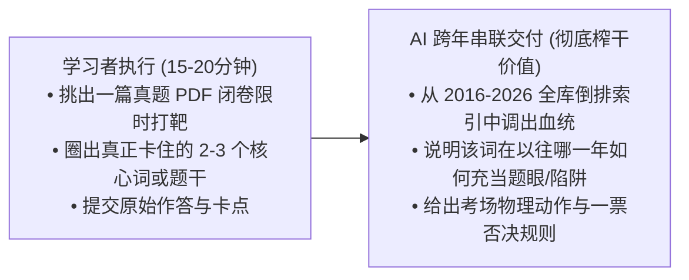

# 英语二 65+ 战略定位与实操计划

> 记录日期：2026-11-03  
> 本文沉淀项目彻底重组后的核心共识与行动规范，取代过去漫无边际的探索、脚手架开发与单句打卡。

---

## 一、 战略总目标：稳定 65+ 的真实容错账本

考研英语二的 65+ 是一个极具实操性、高容错率的分数线。不需要追求“卷面零生词”，更不需要成为语言学专家。

### 1. 得分拆解与容错底线
| 题型 | 满分 | 目标得分 | 允许容错空间 |
| :--- | :---: | :---: | :--- |
| **阅读 Part A** | 40 分 | **28 分** | **允许错 6 题**（20 题对 14 题即可，单篇错 1~2 题都完全达标） |
| **新题型 Part B** | 10 分 | **8 分** | 允许错 1 题（多项对应/小标题，属于基本盘送分题） |
| **大小作文** | 25 分 | **16~17 分** | 依赖 `writing/26.md` 防死锁三切面，卷面工整、结构清晰即可 |
| **英译汉** | 15 分 | **10 分** | 保住主干动作与核心关系，细节允许粗糙 |
| **完形填空** | 10 分 | **5~6 分** | 考场快速打靶，哪怕靠常识和基本语感也能拿到一半 |
| **全卷合计** | 100 分 | **67~71 分** | **安全穿透 65+ 目标线** |

---

## 二、 核心数学认知：真题词汇的真相

基于对 2025 年与 2026 年完整考卷（全客观题题干、选项、正文）的实测数学统计：

1. **相邻年份的阅读覆盖率极低**：
   - 2026 年阅读 Part A 共有 895 个不重复词，2025 年阅读仅重合 276 词（**覆盖率仅 30.8%**）。
   - 哪怕加上 2025 年全卷所有题型（完形+新题型+翻译+写作），总覆盖率也只有 **37.5%**（336/895）。
   - **依然有 62.5%（559 词）未被上一年覆盖**。
2. **未覆盖词的真实属性**：
   - 75% 以上是**初高中及四级基础词**（如 `library, accident, manage, learn, young`）；
   - 20% 是**当年的特定题材词/专有名词**（如 `mcdonald, underground, vendor`）；
   - 真正属于考研深度的超纲/难词**不足 5%**。
3. **关键推论**：
   - 指望“消灭全部生词再做题”是数学上不可能成立的幻觉；
   - 题材词（名词、专有名词）考完即废，不具备跨年流通性，考场直接当**代号 X** 处理；
   - **真正跨年反复流通、决定题目生死的，是 300~500 个高频功能性动词、转折词与评价形容词**（例如 `priorit*` 在 2016–2026 的 11 年中登场了 10 年；`undermine` 在 2022 年是选项题眼，2026 年成为段落核心谓语）。

---

## 三、 四根防踏空安全绳（守住阅读 28 分底线）

在考场全英文环境、无中文中介、时间紧迫下，杜绝“全盘猜题、一脚踏空”的四套物理防御动作：

1. **题干剧透锁定主线**：
   - 读正文前，**先通读 5 道题干**（不看 ABCD 选项）。
   - 题干是命题人写的英文微缩大纲，直接提取出全文讨论的主角、核心争议与作者态度走向，提前焊死理解边界。
2. **首段定性主角与正负极（+/-）**：
   - 首段绝不放行，只提炼两个要素：**主角是谁？作者对它持肯定（+）还是否定（-）态度？**
   - 后文的所有事例和数据，全都是在此基调上的展开与补充。
3. **用“主谓方向”绑架生词**：
   - 遇到生词长句，不做英译中翻查，只做正负电荷与因果判定：`【A】对【B】造成了【坏作用 (-)】`。
   - 考场选项只考大方向，不考词典定义；凭方向符号（+/-）直接对齐选项。
4. **选项三枪淘汰法**：
   - **第一枪**：打死极端绝对词（`all, never, completely, guaranteed`）；
   - **第二枪**：打死无文本对应的陌生生造概念；
   - **第三枪**：打死符合生活常识但原文未提的正能量废话。
   - 哪怕定位句只懂一半，也能通过排除法把候选压缩到 1~2 个。

---

## 四、 人机分工流水线：榨干 2016–2026 真题价值

摆脱“自己回忆旧卷子却找不到、记不清”的认知困境，实行机械化流水线：

### 1. 学习者唯一的执行动作
- 每天固定 10 分钟：滚动刷 `word/` 的 2 个 List（保持高吞吐英文骨架感）；
- 每次训练 15~20 分钟：拿起 `papers/` 中的真题 PDF，全英文限时作答 1 篇（5 题）；
- 提交卡点：只留下当时犹豫的英文词、首选与最终选择，不写冗长分析。

### 2. AI 的交付责任
- **不讲空洞语法大课，不编造虚假模拟**；
- 调取 11 年真题全局数据，精确指出卡点词在历史试卷中的**考查频次、题眼位置、同义替换模式**；
- 将零散词汇固定为跨年份复现的**“常备武器”**，让每次做题都有确定的能力沉淀。
